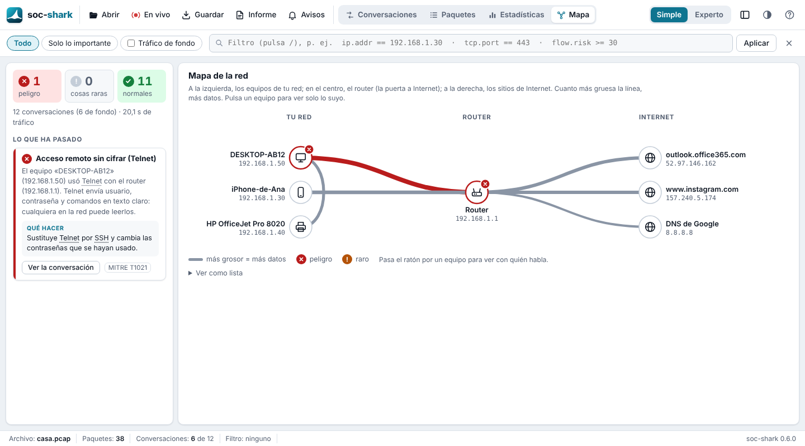
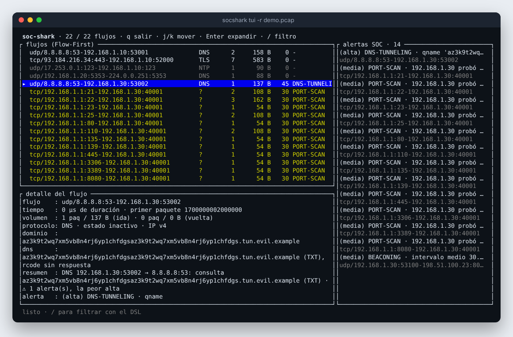

<div align="center">


# SOC SHARK

**Your network, explained in plain language.**<br>
A modern, friendly alternative to Wireshark for SOC / Blue Team analysts — and for everyone else.

**English** · [Español](README.es.md)

[](https://github.com/Ruby570bocadito/soc-shark/actions/workflows/ci.yml)
[](https://github.com/Ruby570bocadito/soc-shark/releases/latest)


<a href="docs/media/demo.mp4"></a>

<sub>▶ 35-second tour of the app · <a href="docs/media/demo.mp4">watch it as MP4</a></sub>

</div>

---

## ⚡ Install in one line

> Downloads the ready-to-run binary for your system from the
> [latest release](https://github.com/Ruby570bocadito/soc-shark/releases/latest),
> checks its SHA-256, puts `socshark` on your `PATH` and tests it with a demo
> capture. **No compiler needed: it takes seconds.** Run it again any time to
> update.

### Windows · PowerShell

```powershell
irm https://raw.githubusercontent.com/Ruby570bocadito/soc-shark/main/install.ps1 | iex
```

### Linux / macOS · bash

```bash
curl -fsSL https://raw.githubusercontent.com/Ruby570bocadito/soc-shark/main/install.sh | bash
```

Then open the app:

```bash
socshark gui
```

<details>
<summary>What each installer does, live capture permissions and options</summary>

- **Windows** ([`install.ps1`](install.ps1)): installs `socshark.exe` into
  `%USERPROFILE%\.socshark\bin` and adds it to your user `PATH`. For **live
  capture** install [Npcap](https://npcap.com) (already there if you have
  Wireshark) with *WinPcap API-compatible Mode* ticked.
- **Linux** ([`install.sh`](install.sh)): installs into `~/.local/bin`, adds
  `libpcap` if it is missing and grants the binary the capture permission
  (`cap_net_raw,cap_net_admin`, the same one Wireshark's `dumpcap` gets), so
  **live capture works without sudo**. The binary runs on any distribution
  with glibc 2.17 or newer (x86_64 and ARM64).
- **macOS**: same script, one universal binary (Apple Silicon and Intel); live
  capture needs `sudo` (or Wireshark's ChmodBPF).
- **No binary for your system, or it fails to start?** The installer builds
  from source instead, installing what that needs (Git, Rust, a C linker; on
  Windows, the Visual Studio C++ Build Tools).
- Options (environment variables): `SOCSHARK_VERSION` (e.g. `0.7.0`; default:
  the latest), `SOCSHARK_FROM_SOURCE=1` (build instead of downloading),
  `SOCSHARK_BIN` (Linux/macOS install folder), `SOCSHARK_NO_SETCAP=1`.

</details>

**Prefer to download it yourself?** Every
[release](https://github.com/Ruby570bocadito/soc-shark/releases/latest) has
`socshark` for Windows (`.zip`), Linux x86_64 and ARM64, and macOS (`.tar.gz`),
plus `SHA256SUMS` to check them: unpack it and run `socshark gui`.

## Why SOC SHARK

Wireshark answers *"what is inside this packet?"*. **SOC SHARK answers *"what
is happening on my network, and what should I worry about?"*** Conversations
instead of packets, meaning instead of hex, alerts instead of endless
scrolling:

- every conversation is **one sentence** — *"The computer «DESKTOP-AB12» used
  Telnet with the router"* — with a ✓ / ! / ✕ status;
- alerts are grouped into **stories** with **what to do** and the
  MITRE ATT&CK technique;
- and when you need the detail, it is all there, Wireshark-style: every
  packet, its layers explained field by field, and its bytes.

## Features

| Feature | What it does |
|---|---|
| 🪟 **GUI** | Conversations in plain language, stories with *what to do*, packet list with layers and highlighted bytes, *Follow stream*, statistics, right-click filters, filter language, light/dark theme. Opens **pcap and pcapng**, saves `.pcap`. |
| 🔴 **Live** | Watch your network in real time: pick Wi-Fi or cable (with its IP and status), the window refreshes every second, *Stop* is instant. Windows (Npcap), Linux and macOS. |
| 🏷️ **Who is who** | Devices by name (*iPhone-de-Ana*, *HP OfficeJet*, *the router*) learned from DHCP, mDNS, LLMNR and NetBIOS; vendor by MAC; your own nicknames; live, **which program** on your computer opened each connection. |
| 🗺️ **Network map** | Your devices, the router and the Internet, and who talks to whom; danger in red; click to filter. |
| 🔔 **Alerts & report** | System notification when something dangerous or odd shows up; a plain-language HTML report to save, print or send. |
| 💻 **TUI** | Flow-First terminal interface (Ratatui): one line per conversation, alerts panel, live DSL filter. |
| 🛡️ **SOC engine** | Mini-IDS: DNS tunnelling, port and network scans, beaconing (T1071), disguised files (T1036), insecure services; JA4 fingerprints and SNI; HTTP file carving with SHA-256; offline threat intel (Feodo, Tor); TCP stream reassembly; full IPv6. |
| 📤 **SIEM export** | JSONL, **Elastic ECS 8.x** and **Wazuh**, with MITRE ATT&CK mapping. |

<table>
  <tr>
    <td width="50%"><br><sub><b>What happened</b>: stories, conversations and what to do</sub></td>
    <td width="50%"><br><sub><b>Network map</b>: devices by name, the router and the Internet</sub></td>
  </tr>
  <tr>
    <td><br><sub><b>Packets</b>: every packet, layers explained, bytes highlighted</sub></td>
    <td><br><sub><b>Statistics</b>: activity over time, protocols and services</sub></td>
  </tr>
  <tr>
    <td colspan="2"><br><sub><b>TUI</b>: the same analysis in the terminal — <code>socshark tui -r capture.pcap</code></sub></td>
  </tr>
</table>

> The interface and the detailed documentation are in Spanish for now.

## Usage

```bash
# Graphical interface: live network, or open / drag a capture (pcap or pcapng)
socshark gui
socshark gui -r capture.pcapng

# Terminal interface
socshark tui -r capture.pcap

# Plain-language report (one HTML file to save, print or send)
socshark report -r capture.pcap -o report.html

# Summary table, JSONL and the filter language (docs/filter-dsl.md)
socshark capture -r capture.pcap
socshark capture -r capture.pcap --json - | jq '.risk_score'
socshark capture -r capture.pcap -f "tcp.port == 443 || flow.risk >= 50"

# Carve HTTP files and detect disguised ones (T1036); offline threat intel
socshark capture -r capture.pcap --carve-files
socshark capture -r capture.pcap --intel-feodo feodo.txt --intel-tor tor-exits.txt

# Follow a reassembled TCP stream
socshark follow -r capture.pcap --flow "93.184.216.34:443"

# Export to a SIEM
socshark export -r capture.pcap -F ecs -o ecs.jsonl
socshark export -r capture.pcap -F wazuh -o wazuh.jsonl

# Live capture from the command line (BPF pushed down to the kernel)
socshark daemon --list
socshark daemon -i eth0 --bpf "tcp port 443" --json flows.jsonl

# No capture at hand? Generate one: an attack demo, or a home network
socshark dev sample-pcap -o demo.pcap
socshark dev sample-pcap --escenario casa -o home.pcap
```

## Build from source

Requirements: [Rust 1.75+](https://rustup.rs) and a C linker. Live capture
also needs libpcap (Linux; built into macOS) or [Npcap](https://npcap.com)
(Windows) at run time — it is loaded on the fly, nothing to link at build
time.

```bash
git clone https://github.com/Ruby570bocadito/soc-shark.git
cd soc-shark
./install.sh                     # builds this copy and installs it; or: cargo build --release
./target/release/socshark gui -r examples/demo.pcap
```

Live capture on Linux without the installer: grant the permission once with
`sudo setcap cap_net_raw,cap_net_admin=eip "$(command -v socshark)"`, or run
it with `sudo`.

## Project status

| Area | Status |
|---|---|
| Capture (files + live), dissectors, flow aggregation, filter DSL | ✅ Done |
| SOC engine: mini-IDS, JA4, beaconing, file carving, threat intel, SIEM export | ✅ Done |
| GUI (live, who is who, map, alerts, report) and TUI | ✅ Done |
| Process attribution with eBPF (today: the system socket table, Linux/Windows) | 🟡 Designed — [ebpf-design.md](docs/ebpf-design.md) |
| Transparent TLS 1.3 decryption (uprobes on `SSL_read/SSL_write`) | 🔵 Planned |
| Sandboxed WASM plugins · CyberChef-style decoder · GeoIP/ASN · TheHive | 🔵 Planned — [roadmap.md](docs/roadmap.md) |

Quality: 200+ unit and integration tests, deterministic fuzzing in CI,
`clippy -D warnings` and `rustfmt` with no exceptions, panic-free parsers
(malformed or hostile packets yield `None`, never a crash) and a minimal set
of dependencies.

<details>
<summary>Repository layout</summary>

```text
soc-shark/
├── crates/
│   ├── socshark-core/         # EnrichedFlow, raw packets, configuration
│   ├── socshark-capture/      # pcap/pcapng reader + live capture (libpcap/Npcap FFI, dlopen)
│   ├── socshark-dissectors/   # Ethernet, IPv4/6, TCP, UDP, DNS, TLS, DHCP… + concurrent pool
│   ├── socshark-flow/         # Bidirectional flow aggregator
│   ├── socshark-filter/       # Filter DSL (lexer, parser, evaluator)
│   ├── socshark-soc/          # Noise, passive DNS, risk, plain language, carving, intel, SIEM export
│   ├── socshark-ebpf-common/  # Types shared between eBPF probes and user space
│   ├── socshark-testgen/      # Frame builders, demo scenarios, fuzzing primitives
│   └── socshark-cli/          # The `socshark` binary: gui, tui, capture, report, daemon…
├── docs/                      # Documentation (Spanish) — start at docs/index.md
├── examples/demo.pcap         # Demo capture
├── install.ps1 · install.sh   # One-line installers
└── .github/workflows/ci.yml   # fmt + clippy + tests + fuzzing
```

</details>

**Documentation** (Spanish): [index](docs/index.md) · [GUI](docs/gui.md) ·
[TUI](docs/tui.md) · [architecture](docs/architecture.md) ·
[filter DSL](docs/filter-dsl.md) · [MITRE ATT&CK mapping](docs/soc-mitre-mapping.md) ·
[SIEM export](docs/siem-export.md) · [security model](docs/security.md) ·
[changelog](CHANGELOG.md)

## Responsible use

SOC SHARK is a **defensive** tool for SOC and Blue Team analysts, researchers
and anyone who wants to understand their own network. Capturing traffic on
networks you do not manage may be illegal where you live: use it only on your
own networks or with explicit permission and, at work, according to your
monitoring policy.

## License

MIT — see [LICENSE](LICENSE).
