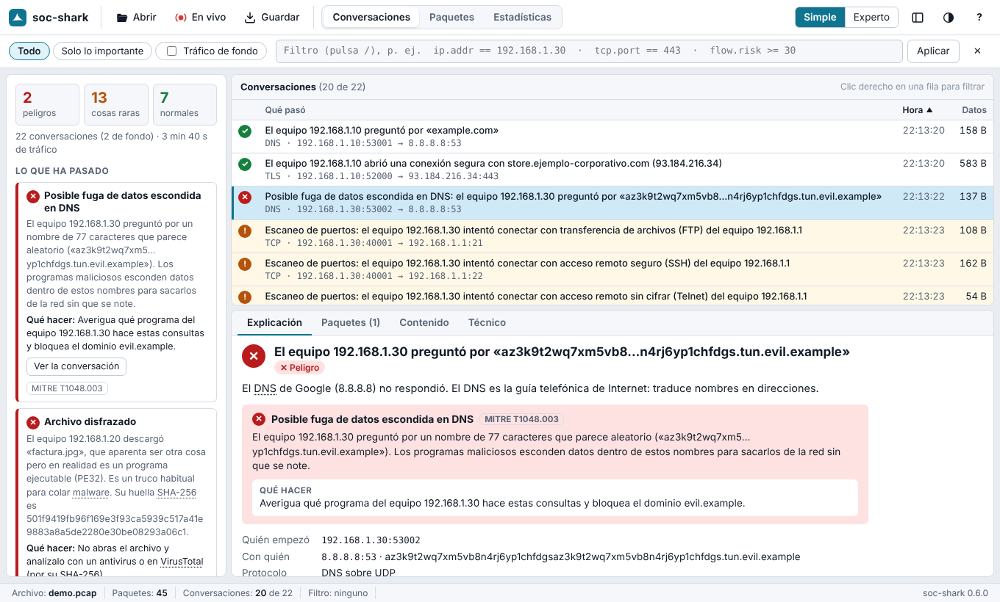
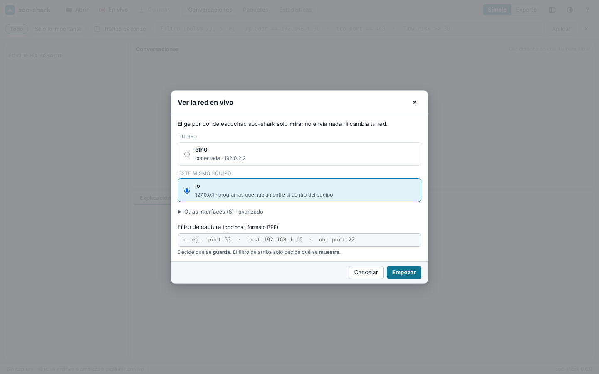
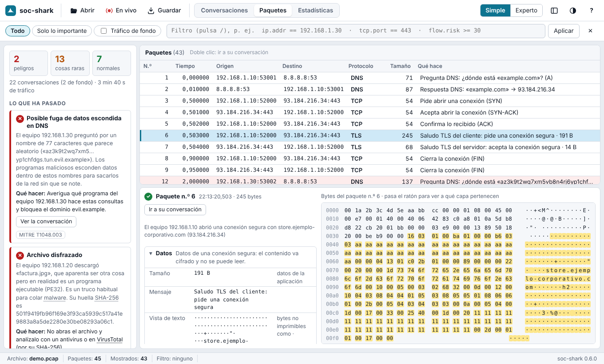
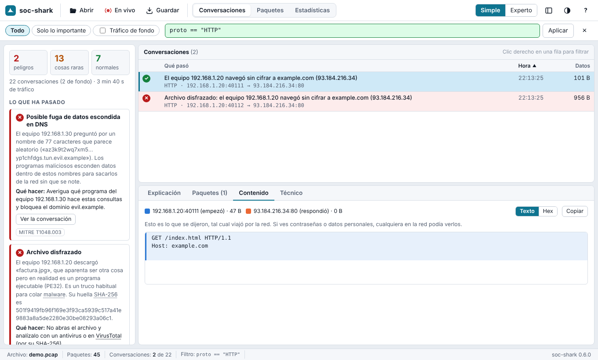
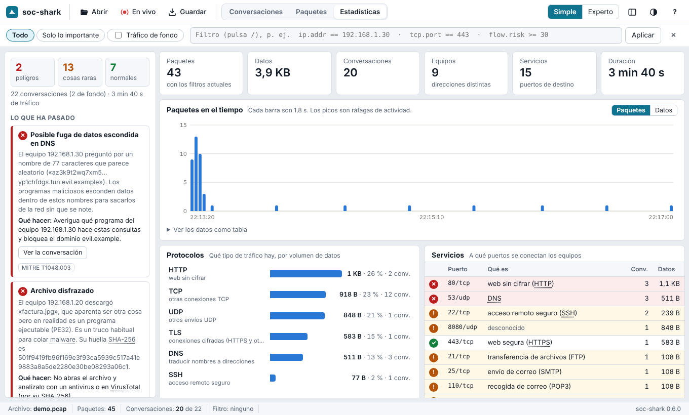

# La GUI de soc-shark

`socshark gui` abre una ventana para explorar una captura **como en
Wireshark, pero explicada para cualquier persona**. Wireshark enseña campos
(`40001 → 22 [SYN] Seq=0 Win=1024`); soc-shark enseña frases: quién habló
con quién, qué hizo, si es normal y qué hacer si no lo es.



## Arranque

```bash
socshark gui                              # ventana vacía: «En vivo» o abrir una captura
socshark gui -r captura.pcap              # abre ya una captura
socshark gui -r captura.pcap --intel-feodo feodo.txt --intel-tor tor.txt
socshark gui --no-open                    # solo imprime la dirección (http://127.0.0.1:8787/)
socshark gui --port 9000                  # otro puerto local
```

La ventana se abre sola: en Windows, como aplicación propia con Edge o
Chrome (modo `--app`, sin barra del navegador); en macOS y Linux, en el
navegador por defecto. Se cierra con **Ctrl+C** en la consola.

Las capturas se pueden abrir con **Abrir**, con **Ctrl+O** o
**arrastrándolas a la ventana**. Formato: pcap clásico (en Wireshark,
*Guardar como → pcap*; un pcapng da un aviso con la forma de convertirlo).

## Ver la red en tiempo real

Botón **En vivo** (o **Ctrl+E**). La ventana pregunta por dónde escuchar y
lo dice en claro: **Tu red** (Wi-Fi o cable, con su dirección IP y si está
conectada), **Este mismo equipo** (loopback) y, plegadas, las interfaces
especiales (Bluetooth, NFLOG, adaptadores virtuales…). Opcionalmente, un
**filtro de captura** BPF (`port 53`, `host 192.168.1.10`…) que decide qué
se guarda; el filtro de la barra superior solo decide qué se muestra.



Mientras captura:

- La ventana se actualiza **cada segundo**: conversaciones, historias,
  paquetes y estadísticas. Lo que estás mirando (la conversación elegida,
  el filtro, el desplazamiento) se conserva.
- En **Paquetes**, la lista **sigue los nuevos** (se puede desmarcar, o
  basta con desplazarse hacia arriba).
- La barra de estado muestra el tiempo capturando, los paquetes y los
  **perdidos por el sistema** si el equipo no da abasto.
- **Detener** es inmediato aunque no pase tráfico (`pcap_breakloop`). Lo
  capturado se queda para revisarlo con calma o **guardarlo** como `.pcap`.

Se guardan los últimos 500.000 paquetes (o 256 MiB) y las últimas 20.000
conversaciones terminadas; lo anterior se descarta para no agotar la memoria.
El tráfico de la propia ventana con soc-shark se excluye automáticamente.

**Permisos.** Capturar exige privilegios:

| Sistema | Qué hace falta |
|---|---|
| Windows | [Npcap](https://npcap.com) (el driver de Wireshark) con «WinPcap API-compatible Mode». Si lo instalaste restringido a administradores, abre la consola como administrador |
| Linux | `sudo socshark gui`, o una vez `sudo setcap cap_net_raw,cap_net_admin=eip $(which socshark)` |
| macOS | `sudo socshark gui`, o permisos de lectura en `/dev/bpf*` (los da el instalador de Wireshark) |

## Qué hay en la ventana

Tres vistas, como las ventanas principales de Wireshark (teclas `1`, `2`, `3`):

| Vista | Qué muestra |
|---|---|
| **Conversaciones** | Una línea por conversación. En modo **Simple**, una frase («El equipo 192.168.1.10 abrió una conexión segura con store.ejemplo-corporativo.com»); en modo **Experto**, las columnas técnicas (inicio, protocolo, origen, destino, paquetes, bytes, duración, riesgo, alertas). Las columnas se ordenan con un clic |
| **Paquetes** | **Todos** los paquetes, uno a uno, como la lista principal de Wireshark: número, tiempo, origen, destino, protocolo, tamaño y una frase («Pide abrir una conexión (SYN)», «Saludo TLS del cliente…»). Coloreados por gravedad. Debajo, las capas explicadas y los bytes. Lista virtual: cientos de miles de paquetes sin bloquear la ventana. Doble clic: ir a su conversación |
| **Estadísticas** | Paquetes o datos **en el tiempo** (picos = ráfagas de actividad), **protocolos** por volumen, **servicios** (puertos de destino, con lo que es cada uno) y **equipos que más hablan** (enviado, recibido, con cuántos, si están en tu red o en Internet). Un clic en cualquier fila filtra por ella |



A la izquierda, siempre (se oculta con **Ctrl+B**):

| Zona | Qué muestra |
|---|---|
| **Resumen** | Cuántas conversaciones son peligro 🔴, raras 🟠 y normales 🟢, y cuánto tráfico hay |
| **Lo que ha pasado** | Las alertas contadas como *historias*: un escaneo de 12 puertos es **una** historia, no 12 líneas. Cada una dice qué pasó y **qué hacer**, con su técnica MITRE ATT&CK enlazada |

Al elegir una conversación, abajo:

| Pestaña | Qué muestra |
|---|---|
| **Explicación** | La frase completa, si es normal, cada alerta explicada con su «qué hacer» y los datos de la conversación (cuándo, volumen, dominio, SNI, huella JA4, archivos extraídos…) |
| **Paquetes** | Los paquetes de esa conversación, con sus **capas** (cada campo y su significado) y sus **bytes**. Al pasar el ratón por una capa se iluminan sus bytes; al pasarlo por un byte, se ilumina su capa |
| **Contenido** | Lo que se dijeron, **tal cual** (el «Seguir flujo» de Wireshark): en azul lo que envió quien empezó, en naranja la respuesta; en texto o en hexadecimal, y con botón para copiar. Avisa si va cifrado o si faltan trozos |
| **Técnico** | El `EnrichedFlow` completo en JSON, igual que `socshark capture --json` |





Las palabras técnicas (DNS, TCP, puerto, SYN, JA4…) aparecen subrayadas:
al pasar el ratón por encima se explican. El glosario completo y ejemplos
de filtros están en la ayuda (**F1** o el botón **?**). Los separadores
entre paneles se arrastran (o se ajustan con las flechas; doble clic los
devuelve a su sitio).

### Filtros

- **Todo** / **Solo lo importante** (oculta lo normal).
- **Tráfico de fondo**: NTP, mDNS y similares están ocultos por defecto
  (*Smart Noise Dimming*).
- **Filtro**: el mismo DSL que `socshark capture -f`
  ([filter-dsl.md](filter-dsl.md)), con historial. Si tiene un error, se
  señala la posición exacta.
- **Clic derecho** en cualquier conversación, paquete, equipo o servicio
  (como «Aplicar como filtro» de Wireshark): ver solo esa conversación, ese
  equipo (`ip.addr == …`), ese puerto o ese protocolo, u **ocultarlo**.
  Con «Añadir al filtro actual» se suma al que ya hay. También copia
  direcciones o el filtro.

Los tres filtros se aplican a la vez a las tres vistas: los números de la
lista, de los paquetes y de las estadísticas siempre cuadran.

### Atajos

| Tecla | Acción |
|---|---|
| `Ctrl`+`E` | Empezar / detener la captura en vivo |
| `Ctrl`+`O` | Abrir captura |
| `Ctrl`+`S` | Guardar como `.pcap` |
| `/` | Escribir un filtro |
| `1` `2` `3` | Conversaciones / Paquetes / Estadísticas |
| `↑` / `↓` | Moverse por la lista |
| `Menú` o `Mayús`+`F10` | Menú de filtros de la fila elegida |
| `Ctrl`+`B` | Mostrar u ocultar el resumen |
| `F1` | Ayuda y glosario |

Se recuerdan entre sesiones: modo, tema, vista, tamaño de los paneles,
historial de filtros, interfaz y filtro de captura.

### Comparado con Wireshark

| Wireshark | soc-shark |
|---|---|
| Lista de paquetes, detalle por capas, bytes | ✅ Igual, con cada capa y campo explicados |
| Captura en vivo con filtro de captura | ✅ (libpcap / Npcap) |
| Filtros de visualización, «Aplicar como filtro» | ✅ Por conversación (DSL propio; no todos los campos de Wireshark) |
| Seguir flujo TCP | ✅ «Contenido» (TCP y UDP) |
| Estadísticas: jerarquía de protocolos, endpoints, gráfica de E/S | ✅ Versión simplificada |
| Guardar / abrir pcap | ✅ pcap clásico (pcapng: aún no) |
| Detectar lo raro y decir qué hacer | ✅ Historias, semáforo, MITRE ATT&CK — Wireshark no lo hace |
| ~3.000 protocolos diseccionados | ❌ Hoy: Ethernet, IPv4/IPv6, TCP, UDP, ICMP, DNS, TLS, HTTP |
| Descifrar TLS con claves, VoIP, Bluetooth/USB, perfiles de color | ❌ No |

## Cómo está hecha

Decisión completa en [ADR-013](decisions.md). En resumen:

- **Página local servida por el propio binario**, sin dependencias nuevas:
  un servidor HTTP/1.1 mínimo (`socshark-cli::gui::http`) y tres archivos
  (`crates/socshark-cli/assets/gui/`: `index.html`, `app.css`, `app.js`)
  incrustados con `include_str!`. Sin frameworks ni CDN: funciona sin
  Internet.
- **El lenguaje claro vive en el motor**, no en la interfaz:
  `socshark-soc::explain` produce el semáforo, las frases, la explicación de
  cada alerta y las historias agrupadas. Cualquier interfaz (CLI, TUI, una
  futura app Tauri) puede reutilizarlo.
- **Índice de paquetes** (`socshark-cli::gui::packets`): tras el pipeline
  de flujos se relee la captura y cada trama se asocia a su conversación con
  la misma clave canónica del agregador (`FlowKey`). Al pedir un paquete se
  vuelve a diseccionar y se cuenta capa a capa, con el rango de bytes de
  cada una. Las tramas se guardan en memoria hasta 256 MiB; por encima, la
  lista sigue disponible pero sin contenido.

### API local

Todas las rutas `/api/*` exigen la cabecera `X-Socshark-Token`.

| Ruta | Respuesta |
|---|---|
| `GET /api/session` | Captura abierta, recuentos y semáforo global |
| `GET /api/stories` | Historias (alertas agrupadas) |
| `GET /api/flows?filter=DSL` | Conversaciones con su `explain`; `400` con `pos` si el filtro es inválido |
| `GET /api/flows/{i}/packets` | Paquetes de una conversación con su frase |
| `GET /api/flows/{i}/stream` | Contenido reensamblado por turnos (seguir flujo) |
| `GET /api/packets?offset&limit&…` | Página de la lista global de paquetes (máx. 1.000 filas) |
| `GET /api/packets/{n}` | Capas explicadas, rangos de bytes y volcado hexadecimal |
| `GET /api/stats?…` | Totales, protocolos, servicios y equipos |
| `GET /api/timeline?…` | Paquetes y bytes por intervalo (120 intervalos) |
| `GET /api/save.pcap` | Lo capturado/abierto como pcap clásico |
| `GET /api/live/ifaces` | Interfaces con descripción, direcciones y estado |
| `POST /api/live/start?iface=…&bpf=…` | Empieza la captura en vivo (sustituye la sesión) |
| `POST /api/live/stop` | La detiene; lo capturado se queda abierto |
| `POST /api/open?name=…` | Analiza la captura enviada en el cuerpo (máx. 512 MiB) |

Las rutas de paquetes, estadísticas y línea de tiempo aceptan los mismos
recortes que la ventana: `filter=DSL`, `noise=0` (sin tráfico de fondo) e
`important=1` (solo raro o peligro). En vivo, cada foto nueva incrementa
`generation` en `/api/session`; la ventana la consulta cada segundo.

## Seguridad

La captura la controla quien genera el tráfico: un nombre de dominio, una
ruta HTTP o un nombre de archivo pueden ser maliciosos. Por eso:

- El servidor **solo escucha en `127.0.0.1`**.
- Se exige la cabecera `Host` local exacta (`127.0.0.1:puerto`,
  `localhost:puerto`): bloquea el *DNS rebinding*.
- Toda la API exige un **token aleatorio de sesión** incrustado en la
  página. Una web ajena abierta en el mismo navegador no puede leerlo (misma
  política de origen) ni enviarlo (cabecera propia ⇒ preflight CORS que
  nunca se aprueba).
- El frontend **nunca usa `innerHTML` con datos**: todo se pinta como
  texto (también en la lista de paquetes, el contenido, las estadísticas y
  los menús). Verificado con una captura cuyo nombre DNS es
  ``: se muestra literal y no se ejecuta nada
  en ninguna vista.
- Ni siquiera estilos en línea: la CSP no admite `style="…"`; la posición
  de las filas y el ancho de las barras se fijan por CSSOM.
- Cabeceras estrictas: CSP `default-src 'none'` (solo los tres archivos
  propios), `X-Frame-Options: DENY`, `nosniff`, `no-store`, `no-referrer`.
- Límites: cabeceras 16 KiB, captura subida 512 MiB, tiempo de lectura 30 s.
- **En vivo**: solo se escucha (en modo promiscuo, como Wireshark); no se
  envía nada a la red. Iniciar una captura exige el token, como el resto de
  la API, así que una web ajena no puede ponerte a capturar.

## Próximos pasos

- Empaquetado como aplicación de escritorio (Tauri) reutilizando el mismo
  frontend.
- Tabla de conversaciones virtualizada (hoy se pintan de 2.000 en 2.000, y
  hasta 10.000; el resto, con un filtro).
- Nombres de equipo (DHCP, mDNS, NetBIOS) en lugar de direcciones IP.
- Abrir pcapng y más protocolos (QUIC, SMB, DHCP…) en la vista de capas.
- Probar la captura en vivo en Windows real con Npcap (verificada con el
  `wpcap.dll` de Wine).
